**Tech stack:** **AWS, GCloud, Exoscale; Kubernetes; Flux CD; Kustomize; Helm; Terraform and OpenTofu; GitLab CI/CD; Docker, Podman; NGINX Ingress and Gateway; Fabric; Cilium; Kyverno; Debezium; Apache Kafka/MSK; RabbitMQ; OpenSearch; Prometheus, Grafana stack, Fluent Bit; Airflow; MLflow; Ollama, vLLM, LocalAI; Gitea, Forgejo; Twingate, Tailscale**

## Open Source Contributions

## Starred projects released in the last year

<!--START_SECTION:starred-projects-->
_Showing the 30 most recently starred of 471 starred repositories whose latest release was published in the past 365 days (700 starred repositories checked). [Complete filtered list](./starred-projects.md)._

```mermaid
flowchart TB
  classDef hub fill:#ddf4ff,stroke:#54aeff,color:#0969da;
  classDef language fill:#f6f8fa,stroke:#d0d7de,color:#24292f;
  classDef project fill:#ffffff,stroke:#d0d7de,color:#24292f;
  hub(("⭐ Showing 30 of 471 matching projects; 700 stars checked"))
  class hub hub;
  lang1["C · 1"]
  class lang1 language;
  hub --> lang1
  p1_1["JustVugg/colibri · 2026-10-31"]
  lang1 --> p1_1
  class p1_1 project;
  lang2["C++ · 1"]
  class lang2 language;
  hub --> lang2
  p2_1["electron/electron · 2026-10-31"]
  lang2 --> p2_1
  class p2_1 project;
  lang3["Clojure · 1"]
  class lang3 language;
  hub --> lang3
  p3_1["logseq/logseq · 2026-10-07"]
  lang3 --> p3_1
  class p3_1 project;
  lang4["Go · 7"]
  class lang4 language;
  hub --> lang4
  p4_1["jkroepke/access-log-exporter · 2026-10-22"]
  lang4 --> p4_1
  class p4_1 project;
  p4_2["NVIDIA/aicr · 2026-11-02"]
  lang4 --> p4_2
  class p4_2 project;
  p4_3["juanfont/headscale · 2026-10-30"]
  lang4 --> p4_3
  class p4_3 project;
  p4_4["kubernetes-sigs/cloud-provider-kind · 2026-10-02"]
  lang4 --> p4_4
  class p4_4 project;
  p4_5["netbirdio/netbird · 2026-10-29"]
  lang4 --> p4_5
  class p4_5 project;
  p4_6["tailscale/tailscale · 2026-11-03"]
  lang4 --> p4_6
  class p4_6 project;
  p4_7["kubernetes-sigs/lws · 2026-10-16"]
  lang4 --> p4_7
  class p4_7 project;
  lang5["HCL · 1"]
  class lang5 language;
  hub --> lang5
  p5_1["AndrewGuenther/fck-nat · 2026-02-03"]
  lang5 --> p5_1
  class p5_1 project;
  lang6["Java · 1"]
  class lang6 language;
  hub --> lang6
  p6_1["strimzi/strimzi-kafka-operator · 2026-10-12"]
  lang6 --> p6_1
  class p6_1 project;
  lang7["JavaScript · 2"]
  class lang7 language;
  hub --> lang7
  p7_1["mindcraft-bots/mindcraft · 2026-03-20"]
  lang7 --> p7_1
  class p7_1 project;
  p7_2["usebruno/bruno · 2026-10-22"]
  lang7 --> p7_2
  class p7_2 project;
  lang8["Lean · 1"]
  class lang8 language;
  hub --> lang8
  p8_1["leanprover/lean4 · 2026-10-12"]
  lang8 --> p8_1
  class p8_1 project;
  lang9["Python · 6"]
  class lang9 language;
  hub --> lang9
  p9_1["sparfenyuk/mcp-proxy · 2026-11-02"]
  lang9 --> p9_1
  class p9_1 project;
  p9_2["Twingate-Labs/Twingate-CLI · 2026-11-02"]
  lang9 --> p9_2
  class p9_2 project;
  p9_3["gke-labs/kube-agents · 2026-10-31"]
  lang9 --> p9_3
  class p9_3 project;
  p9_4["aws-bench/aws-bench · 2026-10-20"]
  lang9 --> p9_4
  class p9_4 project;
  p9_5["triton-inference-server/server · 2026-11-02"]
  lang9 --> p9_5
  class p9_5 project;
  p9_6["aws/tools-for-devops-agent · 2026-09-25"]
  lang9 --> p9_6
  class p9_6 project;
  lang10["Rust · 2"]
  class lang10 language;
  hub --> lang10
  p10_1["cjpais/Handy · 2026-11-02"]
  lang10 --> p10_1
  class p10_1 project;
  p10_2["leanprover/elan · 2026-08-25"]
  lang10 --> p10_2
  class p10_2 project;
  lang11["TypeScript · 7"]
  class lang11 language;
  hub --> lang11
  p11_1["withastro/astro · 2026-11-02"]
  lang11 --> p11_1
  class p11_1 project;
  p11_2["freelensapp/freelens-for-claude-extension · 2026-10-29"]
  lang11 --> p11_2
  class p11_2 project;
  p11_3["freelensapp/freelens-gpu-extension · 2026-10-30"]
  lang11 --> p11_3
  class p11_3 project;
  p11_4["openchamber/openchamber · 2026-11-02"]
  lang11 --> p11_4
  class p11_4 project;
  p11_5["jmaver-plume/kafkajs-msk-iam-authentication-mechanism · 2026-05-12"]
  lang11 --> p11_5
  class p11_5 project;
  p11_6["freelensapp/freelens-kafka-extension · 2026-10-30"]
  lang11 --> p11_6
  class p11_6 project;
  p11_7["hangwin/mcp-chrome · 2025-12-29"]
  lang11 --> p11_7
  class p11_7 project;
```

<!--END_SECTION:starred-projects-->
